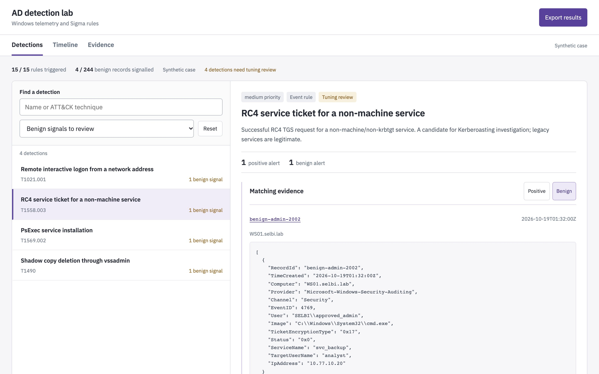
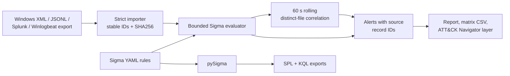
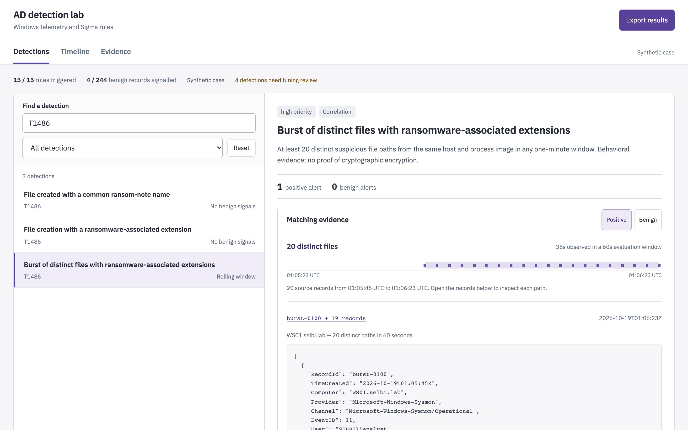
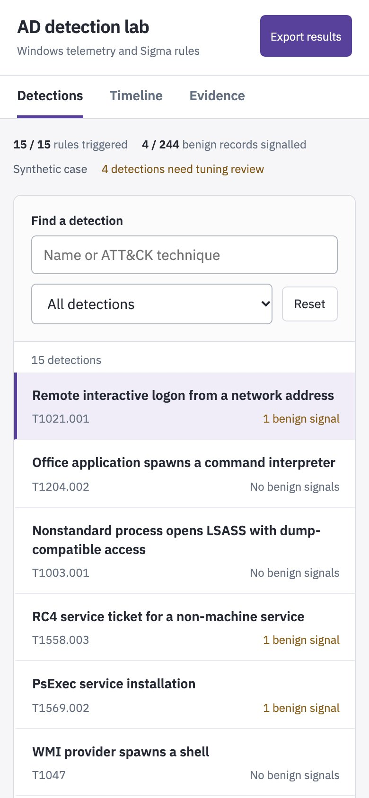

# Ransomware-in-AD detection lab

Each rule here is an attacker technique seen from the defender's side: the moment ransomware operators delete shadow copies, read LSASS memory, push PsExec, request RC4 Kerberos tickets, clear the event log or start rewriting files. The package turns those moments into 15 tested Sigma rules, replays them against positive and benign event sets, exports SPL and KQL, and produces an analyst report that traces every alert back to its source event.



## The attack

The rules follow a ransomware operator's path through a Windows domain: a macro that spawns a shell from an Office document, credential theft from LSASS memory, Kerberoasting with RC4 service tickets, lateral movement with PsExec, WMI and administrative shares, then the impact stage: shadow copies and backup catalogues deleted, boot recovery disabled, Defender switched off, event logs cleared, ransom notes dropped and files rewritten in a burst. Each rule is one of those moves, seen from the defender's side.

## What it does

- Defines 15 detections as **Sigma** rules (a vendor-neutral YAML format for log detections) covering the path from initial access to file impact in a Windows Active Directory domain.
- Replays them locally against 38 positive and 244 benign synthetic events, plus 14 near-miss records that must not fire.
- Converts each rule to Splunk SPL and Microsoft Sentinel KQL with pySigma.
- Builds a self-contained HTML report: a detection queue, the exact source records behind each alert, a timeline, tuning notes and exports.
- Keeps benign hits visible. Four approved admin actions fire on purpose, so tuning is part of the story instead of hidden.

## The 15 rules

ATT&CK IDs come from each rule's `tags` field. ATT&CK is MITRE's public catalogue of attacker techniques.

| # | Rule | ATT&CK | Level |
|---|---|---|---|
| 01 | Remote interactive logon from a network address | T1021.001 | low |
| 02 | Office application spawns a command interpreter | T1204.002 | high |
| 03 | Nonstandard process opens LSASS with dump-compatible access | T1003.001 | high |
| 04 | RC4 service ticket for a non-machine service | T1558.003 | medium |
| 05 | PsExec service installation | T1569.002 | high |
| 06 | WMI provider spawns a shell | T1047 | medium |
| 07 | Shadow copy deletion through vssadmin | T1490 | high |
| 08 | Windows backup catalog deletion | T1490 | high |
| 09 | Boot recovery disabled with bcdedit | T1490 | high |
| 10 | Windows event log cleared using wevtutil | T1070.001 | high |
| 11 | PowerShell requests Defender real-time protection disablement | T1562.001 | high |
| 12 | Executable write requested over an administrative share | T1021.002 | medium |
| 13 | File created with a common ransom-note name | T1486 | medium |
| 14 | File creation with a ransomware-associated extension | T1486 | low |
| 15 | Burst of distinct files with ransomware-associated extensions (correlation) | T1486 | high |

Together they map to 11 distinct techniques and sub-techniques. Every rule is marked `experimental` and has a tuning note in [`docs/rules/`](docs/rules/).

## How it works



The importer normalizes four export formats into one event schema and rejects malformed records, missing required fields and duplicate identities instead of guessing. A small evaluator runs the subset of Sigma the pack uses. Anything outside that subset fails validation, and pySigma separately parses the whole rule collection. The correlation rule groups file-create events by host and process image and fires when 20 distinct paths appear inside any 60-second window. Each alert keeps the record IDs that caused it, so the report can open the exact events behind a detection.

## Design decisions

**A bounded evaluator, not a "full Sigma engine".** Supporting only equality, `contains`, `startswith`, `endswith`, lists and boolean conditions keeps the local matcher small enough to test completely. Unsupported syntax is an error, so the tool never claims semantics it does not have.

**A rolling window, not clock-minute bins.** A burst from 12:00:45 to 12:01:23 is one event, but minute buckets split it in two and can miss the threshold. The bundled burst crosses a minute boundary on purpose: 20 files in 38 seconds.

**Count distinct files, not writes.** Rewriting the same file 50 times is not mass encryption. Paths are compared case-insensitively, as Windows does, and a near-miss test repeats one filename to prove it does not fire.

**Keep benign matches in the report.** Legacy services really do request RC4 tickets, and helpdesks really do use PsExec. Hiding those hits would overstate precision, so the report has a "Benign signals to review" filter and a tuning note for each rule.

**Stable identity and hashes for every input.** XML imports derive a record ID from host, channel, provider, native record number and time, so overlapping exports cannot inflate the correlation count. Each input's SHA256 is recorded, and the report labels data as synthetic only when the hash matches the bundled fixtures.

## Screenshots

<table>
  <tr>
    <td width="68%"></td>
    <td width="32%"></td>
  </tr>
  <tr>
    <td>The burst correlation: 20 distinct files in 38 seconds inside the 60-second window, with every source record one click away.</td>
    <td>The same report on a 390 px phone. List and detail become a single column.</td>
  </tr>
</table>

## Run it

Requires Python 3.12 or newer. No SIEM, Windows VM or network access is needed.

```sh
git clone https://github.com/lilsallix05/ransomware-detection-lab.git
cd ransomware-detection-lab
python3 -m venv .venv
source .venv/bin/activate
python -m pip install -r requirements.lock

python -m adlab validate      # parse all 15 rules
python -m adlab translate     # write queries/splunk/*.spl and queries/kql/*.kql
python -m adlab report        # replay fixtures, write evidence/replay/
python -m adlab.preview       # prints http://127.0.0.1:<port>/report.html
```

Open the printed URL, choose **Benign signals to review**, then open the RC4 rule and switch to **Benign** to see why it fired. Search `T1486` to reach the burst correlation. Stop the preview with Ctrl+C. The report folder is self-contained, so `evidence/replay/report.html` also opens directly from disk.

Your own data:

```sh
python -m adlab import capture.xml --out work/capture.jsonl
python -m adlab replay work/capture.jsonl --out work/alerts.json
python -m adlab report --attack work/positive.jsonl --benign work/benign.jsonl --out work/my-report
```

Malformed input exits with code 2 and a reason. Binary EVTX files must be exported to XML on Windows first.

## Tests

```sh
python -m pytest -q
```

Result on 20 October 2026 (Python 3.14.6, macOS): **71 passed**, 0 failed. The tests cover each rule's positive and near-miss case, window edges, out-of-order events, duplicate identities, malformed imports, report provenance, HTML escaping of event text, and SIEM adapter failure handling. A GitHub Actions workflow (`.github/workflows/detection-ci.yml`) runs the same checks on Python 3.12.

## Scope

- The positive, benign and near-miss events are **synthetic**, written alongside the rules with fictional timestamps. "4 of 244 benign records" is a sample result, not a production false-positive rate.
- One public event from Splunk's `attack_data` repository (Apache-2.0), pinned by commit and SHA256, was replayed and matched rule 04. It validates that one predicate only. See [`evidence/public-replay.json`](evidence/public-replay.json).
- The SPL and KQL were generated, not run in Splunk or Sentinel. The Windows lab scripts in `lab/` have not been executed on Windows.
- Known blind spots: extension checks miss renames and extensionless encryption, grouping by image merges separate processes, and command text does not prove a setting changed.
- Next step: run the [lab setup](docs/lab-setup.md) in an isolated Windows domain, collect a real baseline and execute the queries natively ([SIEM notes](docs/siem.md)).

A longer write-up with the limitations and the reasoning behind them is in [docs/CASE-STUDY.md](docs/CASE-STUDY.md). A sample incident ticket built from the replay is in [docs/INCIDENT-TICKET.md](docs/INCIDENT-TICKET.md).

## Project layout

```text
adlab/                 CLI: importer, Sigma evaluator, translator, report builder, preview server
  report-template.html single-file analyst report
  assets/              IBM Plex Sans (OFL) embedded in reports for offline viewing
rules/                 15 Sigma rules (14 event rules + 1 correlation)
queries/               generated Splunk SPL and Sentinel KQL
fixtures/              synthetic positive, benign and near-miss events; public dataset manifest
tests/                 pytest suite
docs/rules/            one tuning note per rule
docs/                  lab setup, SIEM integration, emulation, sources, case study, incident ticket
lab/                   Windows, Sysmon, WEF, Splunk, Sentinel and Atomic configuration
evidence/              provenance and replay of the public RC4 event
```

---

Built by Selbinyyaz (Salli) Odekova · [Portfolio](https://selbinyyaz-odekova.web.app) · MIT License
